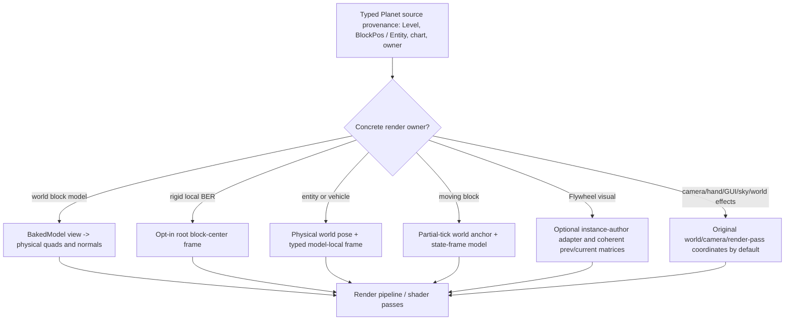

# Planetary 2.3C-14 — camera, items, entities, moving block/render passes and modded-world effects (4/4)

**2026-10-12 · branch `2.0` · target Minecraft 1.21.1 / NeoForge 21.1.215 / Java 21.** One bounded SOURCE/NeoForge PATCH/selected actual classpath ABI/compiled Planet Mixin research package. **No production Mixin/Java changes.** Do not interpret ASM PASS as client Mixin weave, screenshot, arbitrary-mod compatibility, or real shaderpack/Flywheel acceptance. Phase3 owns client render geometry, Phase7 owns entity/vehicle and camera motion semantics, Phase9 owns portal/environment meaning, Phase10 owns optional accelerated mod integrations. This is a follow-on to [C12 AO/shadows](PHASE2_STAGE3C12_LIGHT_AO_BIOME_TINT_NEOFORGE_MODEL_ASM_1_21_1.md), [C13 BER/fluid/shaders](PHASE2_STAGE3C13_ALTERNATE_BER_FLUID_INSTANCING_SHADERS_ASM_1_21_1.md) and [R2 full vanilla client render inventory](CLIENT_RENDER_PARTICLE_MATRIX_1_21_1.md).

## 1/4 — declaring owners, patches and independently rendered paths

Pinned Mojang-mapped **comparative** Minecraft 1.21.1 sources (includes OptiFine additions; not necessarily pristine target behavior): `hackersense/OptiFine-Source@b77c5c6995874f6cf2755bc5234428906b337b75`
- [Camera](https://github.com/hackersense/OptiFine-Source/blob/b77c5c6995874f6cf2755bc5234428906b337b75/1.21.1/net/minecraft/client/Camera.java) (setup, setRotation and view basis), [GameRenderer](https://github.com/hackersense/OptiFine-Source/blob/b77c5c6995874f6cf2755bc5234428906b337b75/1.21.1/net/minecraft/client/renderer/GameRenderer.java), [LevelRenderer](https://github.com/hackersense/OptiFine-Source/blob/b77c5c6995874f6cf2755bc5234428906b337b75/1.21.1/net/minecraft/client/renderer/LevelRenderer.java) (entity/BE/weather/sky/hand independent passes).
- [EntityRenderDispatcher](https://github.com/hackersense/OptiFine-Source/blob/b77c5c6995874f6cf2755bc5234428906b337b75/1.21.1/net/minecraft/client/renderer/entity/EntityRenderDispatcher.java), [LivingEntityRenderer](https://github.com/hackersense/OptiFine-Source/blob/b77c5c6995874f6cf2755bc5234428906b337b75/1.21.1/net/minecraft/client/renderer/entity/LivingEntityRenderer.java) (model root vs dispatcher shadow, fire, hitboxes).
- [ItemRenderer](https://github.com/hackersense/OptiFine-Source/blob/b77c5c6995874f6cf2755bc5234428906b337b75/1.21.1/net/minecraft/client/renderer/entity/ItemRenderer.java), [ItemEntityRenderer](https://github.com/hackersense/OptiFine-Source/blob/b77c5c6995874f6cf2755bc5234428906b337b75/1.21.1/net/minecraft/client/renderer/entity/ItemEntityRenderer.java), [ItemFrameRenderer](https://github.com/hackersense/OptiFine-Source/blob/b77c5c6995874f6cf2755bc5234428906b337b75/1.21.1/net/minecraft/client/renderer/entity/ItemFrameRenderer.java), [ItemInHandRenderer](https://github.com/hackersense/OptiFine-Source/blob/b77c5c6995874f6cf2755bc5234428906b337b75/1.21.1/net/minecraft/client/renderer/ItemInHandRenderer.java).
- [FallingBlockRenderer](https://github.com/hackersense/OptiFine-Source/blob/b77c5c6995874f6cf2755bc5234428906b337b75/1.21.1/net/minecraft/client/renderer/entity/FallingBlockRenderer.java), [MinecartRenderer](https://github.com/hackersense/OptiFine-Source/blob/b77c5c6995874f6cf2755bc5234428906b337b75/1.21.1/net/minecraft/client/renderer/entity/MinecartRenderer.java), [BoatRenderer](https://github.com/hackersense/OptiFine-Source/blob/b77c5c6995874f6cf2755bc5234428906b337b75/1.21.1/net/minecraft/client/renderer/entity/BoatRenderer.java), [TntRenderer](https://github.com/hackersense/OptiFine-Source/blob/b77c5c6995874f6cf2755bc5234428906b337b75/1.21.1/net/minecraft/client/renderer/entity/TntRenderer.java), [PistonHeadRenderer](https://github.com/hackersense/OptiFine-Source/blob/b77c5c6995874f6cf2755bc5234428906b337b75/1.21.1/net/minecraft/client/renderer/blockentity/PistonHeadRenderer.java), [ScreenEffectRenderer](https://github.com/hackersense/OptiFine-Source/blob/b77c5c6995874f6cf2755bc5234428906b337b75/1.21.1/net/minecraft/client/renderer/ScreenEffectRenderer.java).

Pinned *later* official NeoForge 1.21.1 comparative patch version `neoforged/NeoForge@3cae64530de368936d4c07497d3f0a25e2f9ffec`, **NOT assumed identical to exact 21.1.215**:
- [EntityRenderDispatcher.patch](https://github.com/neoforged/NeoForge/blob/3cae64530de368936d4c07497d3f0a25e2f9ffec/patches/net/minecraft/client/renderer/entity/EntityRenderDispatcher.java.patch): `EntityRenderersEvent.AddLayers`, mod renderers rather than closed vanilla subclasses.
- [ItemRenderer.patch](https://github.com/neoforged/NeoForge/blob/3cae64530de368936d4c07497d3f0a25e2f9ffec/patches/net/minecraft/client/renderer/entity/ItemRenderer.java.patch): `IClientItemExtensions.getCustomRenderer().renderByItem` for custom-rendered items.
- [ItemFrameRenderer.patch](https://github.com/neoforged/NeoForge/blob/3cae64530de368936d4c07497d3f0a25e2f9ffec/patches/net/minecraft/client/renderer/entity/ItemFrameRenderer.java.patch): cancellable `RenderItemInFrameEvent`, do NOT bypass its suppression.
- [PistonHeadRenderer.patch](https://github.com/neoforged/NeoForge/blob/3cae64530de368936d4c07497d3f0a25e2f9ffec/patches/net/minecraft/client/renderer/blockentity/PistonHeadRenderer.java.patch): `ClientHooks.renderPistonMovedBlocks` owns mod block moving tessellation and RenderType.
- [GameRenderer.patch](https://github.com/neoforged/NeoForge/blob/3cae64530de368936d4c07497d3f0a25e2f9ffec/patches/net/minecraft/client/renderer/GameRenderer.java.patch) and [LevelRenderer.patch](https://github.com/neoforged/NeoForge/blob/3cae64530de368936d4c07497d3f0a25e2f9ffec/patches/net/minecraft/client/renderer/LevelRenderer.java.patch): mod shader/FOV hooks, render stages AFTER_SKY/ENTITIES/BLOCK_ENTITIES/PARTICLES/WEATHER/LEVEL; preserve original shader/opaque state and event order. [RenderHandEvent](https://github.com/neoforged/NeoForge/blob/3cae64530de368936d4c07497d3f0a25e2f9ffec/src/main/java/net/neoforged/neoforge/client/event/RenderHandEvent.java): cancellable custom first-person hand/held item path.

Pinned **actual mod source comparator** `Creators-of-Create/Create@7ff2760e4924d35d4bc2e22c4b19923f0178cd16`:
- [FlywheelRenderer](https://github.com/Creators-of-Create/Create/blob/7ff2760e4924d35d4bc2e22c4b19923f0178cd16/src/main/java/com/simibubi/create/content/kinetics/flywheel/FlywheelRenderer.java) returns early when `VisualizationManager.supportsVisualization`; otherwise renders a traditional BER path.
- [FlywheelVisual](https://github.com/Creators-of-Create/Create/blob/7ff2760e4924d35d4bc2e22c4b19923f0178cd16/src/main/java/com/simibubi/create/content/kinetics/flywheel/FlywheelVisual.java) creates separately rotated shaft and wheel GPU instances, caches a base matrix, animates angle each `beginFrame(partialTick)`, and updates lighting with `relight`. This independent active path is never guaranteed to call Planet BER or `BakedQuad` adapter.
- [ContraptionVisual](https://github.com/Creators-of-Create/Create/blob/7ff2760e4924d35d4bc2e22c4b19923f0178cd16/src/main/java/com/simibubi/create/content/contraptions/render/ContraptionVisual.java) embeds structure and child visuals in a `VisualEmbedding`, uses `VirtualRenderWorld`, physical/virtual positions and shader light; cannot blindly treat fake Levels as current Planet ClientLevel.
- [SingleAxisRotatingVisual](https://github.com/Creators-of-Create/Create/blob/7ff2760e4924d35d4bc2e22c4b19923f0178cd16/src/main/java/com/simibubi/create/content/kinetics/base/SingleAxisRotatingVisual.java): rotateToFace on independent instance and updateLight/relight callbacks. Mod-owned state-axis may itself be **canonical**, or physically projected already; both cannot be rotated a second time.

Shader source reference: [Iris gbuffers programs](https://shaders.properties/current/reference/programs/gbuffers/) separate terrain, damagedblock, block entity, entities, translucent entity, first-person hand, sky, weather, beacon beams and water. [Entity properties](https://shaders.properties/current/reference/miscellaneous/entity_properties/) further give explicit `minecraft:entity_shadow`, `entity_flame`, `current_player`, nametag categories, useful when diagnosing failed passes. `gbuffersPreviousModelView`/previous camera data and shadow-pass matrices affect interpolation and temporal effects; [matrix reference](https://shaders.properties/current/reference/uniforms/matrices/). Evidence is shader **contract/source**, not actual loaded shaderpack behavior.

## 2/4 — lifecycle and precise physical vs canonical contract

| Owner/callback family | Physical state to preserve | Optional local/chart semantics and bypass |
| --- | --- | --- |
| `Camera.setup` + `setRotation` | physical eye world position, camera world rotation, view-space basis; third-person ray from physical eye | Planet CameraGravityMixin composes local camera frame and interpolates its transition once, with eye position from local UP. Avoid independently moving world view matrix or shader uniforms. |
| `GameRenderer` / `LevelRenderer` | projection, level render view/inverse, frustum, sky, clouds/weather, mod RenderLevelStageEvent, hand/UI overlays and post-processing | gameplay camera may rotate; sky/world global physical light remains physical; weather may have distinct local-fall policy. Do not wrap whole renderLevel with per-face PoseStack rotation. |
| `EntityRenderDispatcher.render` | physical x/y/z partial interpolation, world-space fire, projected ground shadow, hitbox/nametag/frustum, original vanilla and NeoForge mod renderer dispatch | body local rotation belongs to model-specific safe adapter. **Unregistered** `EntityRenderDispatcherGravityMixin` exists in source but is intentionally absent from current `planetary.mixins.json`, whereas `LivingEntityRendererGravityMixin` is registered; enabling both may double-rotate living body and alter world effects. |
| `LivingEntityRenderer.render`, `PlayerRenderer.setupRotations` | partial ticks, model/texture/layers, local body yaw vs physical world view, NeoForge AddLayers | existing LivingEntityRenderer adapter rotates body after its own PoseStack push; PlayerRenderer converts world view vector to local before rotation. Do NOT globally intercept all entity model quaternions. |
| `ItemRenderer.render/renderStatic`, `ItemInHandRenderer`, BEWLR | inventory/GUI or held item **no world BlockPos**, `ItemDisplayContext`, `ItemStack`, per-mod custom item callbacks, first-person camera basis | fallback standard item model should retain native camera/inventory semantics; when an ItemFrame or held object has known Planet spatial owner, pass explicit placement intent instead of assigning chart to item globally. |
| `ItemEntityRenderer` vs `ItemFrameRenderer` | item drop gravity bob/rotation and stacking, item-frame entity physical attached `Direction`, hit/rotation, item-frame event veto | loose item bounce/spin policy Phase7; frame attachment under local gravity must be resolved from the actual source entity/BlockPos, not just player camera frame. Never cancel NeoForge event. |
| `FallingBlockRenderer` | physical entity anchor/world frame position, light and model placement (entity actor) | existing `PlanetFallingBlockRender` converts local-DOWN block-face center to physical cell center; do not multiply this with unregistered global dispatcher rotation; seam interp needs source+target frame ownership. |
| `PistonHeadRenderer` and `PistonMovingBlockEntity` | moving physical motion offsets `getXOff/YOff/ZOff(partialTick)`, state copied into renderer, independent BE light and NeoForge custom moving-block rendering | physical translation vs block canonical model orientation distinct; follow Phase2.3C-8 piston lifecycle and Phase7 movement semantics. |
| `MinecartRenderer`, `BoatRenderer`, `TntRenderer`, third-party EntityRenderer | world pose of vehicle/entity, rail graph tangent/boat buoyancy, hurt/bubble angle, dropped block display, entity animations | Phase7 body physics local orientation must provide typed world pose to each family. Nonliving entities are **not** covered by the currently active LivingEntityRenderer Mixin. |
| `ScreenEffectRenderer`, weather, particles, beams, portals, debug lines, flames, ground shadows | physical sampling and world/camera-space special effects often bypass BakedModel | screen `getOverlayBlock` already samples local eye corners; beam/sky/cloud/ground shadow should not automatically follow local up, especially near corners and shaderpacks. |
| Flywheel `DynamicVisual`/`ShaderLightVisual`, `VisualEmbedding` | physical/virtual render Level, GPU instance transforms, tick/partialTick/current-prev frames, normal matrix, relight updates, shadow/damaged texture pass | require opt-in versioned renderer adapter at **original instance authoring boundary** with owner provenance; no universal RenderType/vertex shims. |

**Non-obvious caveats (source-level, not demonstrated bugs):** world-shadow `EntityRenderDispatcher.renderShadow` uses a world-Y floor-neighborhood projection and separate brightness/occlusion; a player standing on a side Planet face might have a body rotated correctly yet vanilla shadow rendered toward world-DOWN, independent of Iris real shadow mapping. Entity world-space flames/billboard, name tag and held item need own classification. `CameraGravityMixin` adjusts rotated `forwards/up/left` vectors and eye position; GameRenderer may apply independent first-person matrix transforms and mods can cancel `RenderHandEvent`. Motion vectors must use consistent current and previous body+camera+instance transforms, not instantaneous face snapshots only. `EntityRenderDispatcherGravityMixin` currently unregistered — do not mark it active or patch it to address phantom faults.

## 3/4 — deepest-safe shared integration architecture

| Classification | Safest owner and rule |
| --- | --- |
| **PHYSICAL_DO_NOT_TOUCH** | World position/voxel/sky/sun, world and view/project matrices, `RenderLevelStageEvent`, frustum, arbitrary `EntityRenderer`, billboard, foreign `VirtualRenderWorld`; never globally rewrite `Axis.YP`, `PoseStack`, `VertexConsumer`, `Direction`, `BlockPos`, `ItemDisplayContext` or physical light. |
| **SHARED_SAFE** | `PlanetGravityFrame` pure rotation and physical/canonical mapping, per-owner typed render context when world provenance is known, existing BakedModel + rotated normals, stable pose interpolation utilities. Preserve callbacks, mod RenderType, model data and pose push/pop. |
| **OPT_IN_ALGORITHM** | Different policy by model-space vs world-space vs camera-space; vehicle frame/body face and physical rail motion; item-frame attachment semantics; entity ground shadow projection; moving BE block state+physical delta; Flywheel instance authoring. No implicit opt-in for arbitrary modded renderer. |
| **MOD_INDEPENDENT** | Mod `EntityRenderer`, custom BEWLR, NeoForge RenderItemInFrameEvent/RenderHandEvent, custom BER shader, Flywheel/contraption visual, Sodium terrain renderer, Iris shadow/hand/water stages, custom shader entity IDs; real binaries must be loaded to claim pass. |
| **CLIENT_RENDER** | Phase3 camera/pose/render/stage, Phase7 entity/vehicle gravity, Phase9 world environment/portal policy, Phase10 external engine. Validating one stage never proves all shadow/normal passes. |

**Why not lower:** universal wrapping of `EntityRenderDispatcher` transforms the rigid entity body *and* physical shadows, flames, world-space name tags, and third-party entity implementations; global modelview/shader projection changes all dimension/render contexts. **Why not higher:** individual player/zombie/item/minecart patches fail mod subclasses and other render stages. Use the deepest genuinely typed engine-owner boundary; classify runtime-space semantics and allow independent mod visual APIs.

Portability: core `PlanetGravityFrame` and partial-tick transform semantic composition independent of MC version; thin 1.21.1 classes` @At`/NeoForge patched hooks/AO/render stage API remain version-locked and ASM-tested. Optional GPU/shader mods must never load on a server as a hard dependency.

## 4/4 — target ASM/JUnit and independent acceptance

[Phase23C14CameraEntityItemRenderAsmContractTest](../../src/test/java/dev/planetary/world/Phase23C14CameraEntityItemRenderAsmContractTest.java) tests **selected actual Gradle-loaded NeoForge 21.1.215 classfiles** (exact Camera/EntityRenderDispatcher/LivingEntityRenderer/FallingBlockRenderer method descriptors, vanilla and modded entity/item/camera/world effect render call categories, `PistonHeadRenderer.renderPistonMovedBlocks` override, selected NeoForge level stages), and **compiled Planet Mixin** method selector/descriptor registration. Compiled success does not verify applied transformer or GPU. Tests are intentionally strict on selected contract; a failure requires inspection of true target owner/classfile rather than `require=0`. No production Mixin/Java modified.

| Gate | Status |
| --- | --- |
| 1. Pinned Mojang comparative source + official NeoForge patch + Create source owner inventory | RESEARCH 4/4 completed |
| 2. Lifecycle and separate physical/local/camera/virtual sources, all alternate paths | DOCUMENTED |
| 3. Exact compiled NeoForge21.1.215 selected ABI and compiled Planet Mixin annotation contract | **CI PASS** after one test-only correction |
| 4. Java compilation, JUnit, registry | **PASS** — [Actions38300577734](https://github.com/Abbygree11/Planetary/actions/runs/38300577734) |
| Applied 1.21.1 NeoForge Mixin startup and renderer injection | NOT RUN |
| Actual Create 1.21.1 Flywheel visuals and fallback BER plus contraption VirtualRenderWorld | NOT RUN |
| Iris shaderpack hand, entity, block, ground-shadow vs actual shadow map, weather and motion temporal | NOT RUN |
| POS_Y vanilla, six Planet faces, 12 seams, 8 corners; single/multiple entity families and non-Planet worlds | NOT RUN |

Manual future visual fixtures (separate screenshot and telemetry proofs for each rendering family): Player/armor/cape/held map/first-person hand/offhand, living mobs and mod entity, dropped item bob/rotation, ItemFrame with attached item and map and mod event cancellation, minecart with block contents on six local rail orientations, boat in water and transitions, TNT/primed falling block anchor, moving piston with modded moving BlockState/RenderType, Create flywheel both visual GPU and fallback BER modes, Create contraption virtual world and child visuals, vanilla projected ground shadow, flame and hitboxes, rain/snow/cloud/sky/beacon/portal, third-person/frustum near six seams, shaderpack gbuffer_terrain/entities/hand/weather/shadow passes plus previous matrices and shadow camera, reverse F5/first person, no-Planet level or foreign Level. Compare physical matrices/normal frame/pose current-vs-previous, light/RenderType, no double rotations, and capture actual loaded mod/pack version/hash. Real Phase3/7/10 gameplay acceptance remains separate.

**Next candidate:** `2.3C-15` only after CI confirmation, likely selected remaining NeoForge client lifecycle/resource reload/particle/weather/auxiliary renderer owner family; use roadmap to avoid duplicating exhaustive R2 particle research. End source packet here, do not silently implement runtime.

### Verified selected ABI JUnit CI delta, 2026-10-12

[First CI38300054685](https://github.com/Abbygree11/Planetary/actions/runs/38300054685) compiled Java but failed **1 of 393 tests** at newly-added GameRenderer method-presence expectation: `renderHand` was from the comparative **OptiFine-modified** decompilation, not the true NeoForge 21.1.215 GameRenderer. Real vanilla/NeoForge 1.21.1 [GameRenderer API](https://lexxie.dev/neoforge/1.21.1/net/minecraft/client/renderer/GameRenderer.html) declares private `renderItemInHand(Camera,float,Matrix4f)`. [Test-only revision 93628fc](https://github.com/Abbygree11/Planetary/commit/93628fc5799cd0da4f3fe38c155f20ffb2ef6426) pins this original method instead; **no production patch**. [Repeat GitHub Actions38300577734](https://github.com/Abbygree11/Planetary/actions/runs/38300577734) **COMPLETED SUCCESS**: production/test compilation, selected target21.1.215 camera/entity/item/piston/NeoForge render-stage/Planet Mixin bytecode JUnit contracts and original registry census. Not applied client Mixin or GPU shaders/mods/gameplay; the 4/4 research-only packet is closed. Next C15 resource/client lifecycle family.
