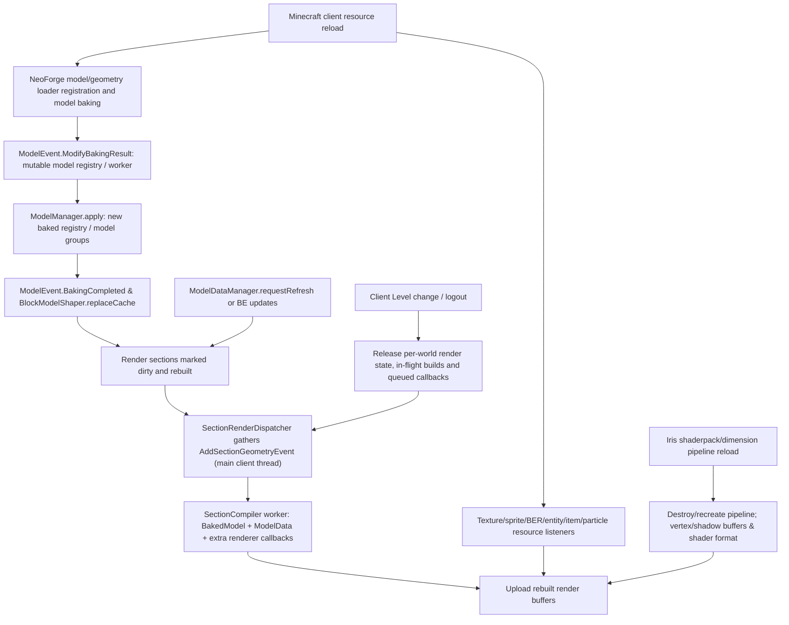

# Planetary — Phase 2.3C-15: resource reload, model lifecycle, custom section geometry, weather/sky & shaders

**2026-10-12 · branch `2.0` · target Minecraft 1.21.1 / NeoForge 21.1.215 / Java 21.**

**Research-only full 4/4 bounded owner-family stage.** Exact loaded Gradle NeoForge JVM classes / selected current Planet cache ABI verified separately through [new JUnit ASM contract](../../src/test/java/dev/planetary/world/Phase23C15ResourceReloadSectionEffectsAsmContractTest.java) and CI after execution. No productive Java/Mixin patch, applied Mixin, screenshot, loaded shaderpack, or third-party JAR acceptance. Builds on [R2](CLIENT_RENDER_PARTICLE_MATRIX_1_21_1.md), [C11 render culling](PHASE2_STAGE3C11_SHAPES_OCCLUSION_SUPPORT_RENDER_CULLING_NEOFORGE_ASM_1_21_1.md), [C12 AO/light](PHASE2_STAGE3C12_LIGHT_AO_BIOME_TINT_NEOFORGE_MODEL_ASM_1_21_1.md), [C13 alt BER/fluid/shader](PHASE2_STAGE3C13_ALTERNATE_BER_FLUID_INSTANCING_SHADERS_ASM_1_21_1.md) and [C14 camera/entity/hand/visual](PHASE2_STAGE3C14_CAMERA_ENTITY_ITEM_MOVING_WORLD_EFFECTS_ASM_1_21_1.md). **Do not re-audit particle emitter semantics already completed in R2.**

## 1/4 — source, patch and actual target ABI: complete owner inventory

Mojang-mapped **comparative** Minecraft 1.21.1 source under `hackersense/OptiFine-Source@b77c5c6995874f6cf2755bc5234428906b337b75` (**OptiFine alterations exist; NEVER assume extra methods match NeoForge target**):
- [ModelManager](https://github.com/hackersense/OptiFine-Source/blob/b77c5c6995874f6cf2755bc5234428906b337b75/1.21.1/net/minecraft/client/resources/model/ModelManager.java) `reload -> loadModels -> apply -> bakedRegistry, BlockModelShaper.replaceCache`; [ModelBakery](https://github.com/hackersense/OptiFine-Source/blob/b77c5c6995874f6cf2755bc5234428906b337b75/1.21.1/net/minecraft/client/resources/model/ModelBakery.java) per-reload baked cache; [BlockModelShaper](https://github.com/hackersense/OptiFine-Source/blob/b77c5c6995874f6cf2755bc5234428906b337b75/1.21.1/net/minecraft/client/renderer/block/BlockModelShaper.java) state model cache replacement.
- [Minecraft](https://github.com/hackersense/OptiFine-Source/blob/b77c5c6995874f6cf2755bc5234428906b337b75/1.21.1/net/minecraft/client/Minecraft.java) resource-manager listener registration, resource-pack reload, `LevelRenderer.allChanged` after reload, `setLevel` transition and client-only renderer listeners; [LevelRenderer](https://github.com/hackersense/OptiFine-Source/blob/b77c5c6995874f6cf2755bc5234428906b337b75/1.21.1/net/minecraft/client/renderer/LevelRenderer.java) `onResourceManagerReload / setLevel / allChanged / setBlocksDirty / renderSky / renderClouds / renderSnowAndRain / tickRain`. The block renderer, entity/BER dispatchers, item renderer and particle engine each have independent reload owners.
- [SectionCompiler](https://github.com/hackersense/OptiFine-Source/blob/b77c5c6995874f6cf2755bc5234428906b337b75/1.21.1/net/minecraft/client/renderer/chunk/SectionCompiler.java) and section dispatcher build thread; physical `RenderChunkRegion` vs absolute/relative BlockPos and render PoseStack need different provenance.

Official comparative NeoForge 1.21.1 fixed source `neoforged/NeoForge@3cae64530de368936d4c07497d3f0a25e2f9ffec` (**later source revision can differ from exact 21.1.215**):
- [ModelManager patch](https://github.com/neoforged/NeoForge/blob/3cae64530de368936d4c07497d3f0a25e2f9ffec/patches/net/minecraft/client/resources/model/ModelManager.java.patch) calls `ClientHooks.onModifyBakingResult` in worker-side baking and `ClientHooks.onModelBake` after model assignment, before `BlockModelShaper.replaceCache`. [ModelEvent](https://github.com/neoforged/NeoForge/blob/3cae64530de368936d4c07497d3f0a25e2f9ffec/src/main/java/net/neoforged/neoforge/client/event/ModelEvent.java): `RegisterAdditional`, `ModifyBakingResult` (mutable registry and unsafe to access partially reloading `ModelManager`), `BakingCompleted` (mod event after cached model setup per documentation; inspect exact compiled event sequence, do not assume ordering beyond verified patched code). **Worker vs main render-thread boundary matters.**
- [RegisterClientReloadListenersEvent](https://github.com/neoforged/NeoForge/blob/3cae64530de368936d4c07497d3f0a25e2f9ffec/src/main/java/net/neoforged/neoforge/client/event/RegisterClientReloadListenersEvent.java): registration event is fired *once while constructing Minecraft*; listeners themselves run on reloads. Server-side AddReloadListenerEvent is separate. Planet must not register a new listener on every model bake/level join.
- [SectionCompiler patch](https://github.com/neoforged/NeoForge/blob/3cae64530de368936d4c07497d3f0a25e2f9ffec/patches/net/minecraft/client/renderer/chunk/SectionCompiler.java.patch) adds `ClientHooks.addAdditionalGeometry` beyond the vanilla block state loop; [SectionRenderDispatcher patch](https://github.com/neoforged/NeoForge/blob/3cae64530de368936d4c07497d3f0a25e2f9ffec/patches/net/minecraft/client/renderer/chunk/SectionRenderDispatcher.java.patch) gathers renderer callbacks before dispatching worker rebuild, even for otherwise empty sections.
- [AddSectionGeometryEvent](https://github.com/neoforged/NeoForge/blob/3cae64530de368936d4c07497d3f0a25e2f9ffec/src/main/java/net/neoforged/neoforge/client/event/AddSectionGeometryEvent.java): event on **main client thread**, captures a `Level` that may **differ** from current Minecraft client Level (e.g. guidebook); `AdditionalSectionRenderer.render(SectionRenderingContext)` executes on rebuild worker with `BlockAndTintGetter region`, `PoseStack`, layer buffers and NeoForge `QuadLighter`. It bypasses vanilla per-block BakedModel adaptation entirely; no generic rotated vertex interception is safe.
- [ModelDataManager](https://github.com/neoforged/NeoForge/blob/3cae64530de368936d4c07497d3f0a25e2f9ffec/src/main/java/net/neoforged/neoforge/client/model/data/ModelDataManager.java) main-client-thread `requestRefresh(BE)` with level ownership check, `getAt` + `snapshotSectionRegion` to build worker-safe view. ModelData updates are NOT resource-pack reloads and require a distinct section/cache invalidation lifetime.
- [LevelRenderer patch](https://github.com/neoforged/NeoForge/blob/3cae64530de368936d4c07497d3f0a25e2f9ffec/patches/net/minecraft/client/renderer/LevelRenderer.java.patch) delegates alternative sky/rain/cloud render and tick to `level.effects()` and emits distinct `RenderLevelStageEvent` passes; [IDimensionSpecialEffectsExtension](https://github.com/neoforged/NeoForge/blob/3cae64530de368936d4c07497d3f0a25e2f9ffec/src/main/java/net/neoforged/neoforge/client/extensions/IDimensionSpecialEffectsExtension.java) exposes `renderSky / renderClouds / renderSnowAndRain / tickRain` opt-out callbacks. [RenderLevelStageEvent](https://github.com/neoforged/NeoForge/blob/3cae64530de368936d4c07497d3f0a25e2f9ffec/src/main/java/net/neoforged/neoforge/client/event/RenderLevelStageEvent.java) supports mod-defined RenderType stages and world/view/projection camera metadata.
- [ClientHooks](https://github.com/neoforged/NeoForge/blob/3cae64530de368936d4c07497d3f0a25e2f9ffec/src/main/java/net/neoforged/neoforge/client/ClientHooks.java) dispatches model baking, geometry events, render stages; `reloadRenderer` independent renderer-rebuild trigger.

Independent real **Iris shader renderer** comparator `IrisShaders/Iris@eb7afb99f747cc8ed5ee4072119539035d33cefd` from 1.21.1 branch:
- [PipelineManager](https://github.com/IrisShaders/Iris/blob/eb7afb99f747cc8ed5ee4072119539035d33cefd/common/src/main/java/net/irisshaders/iris/pipeline/PipelineManager.java) holds dimension-specific pipelines and `destroyPipeline()`, which clears them and increments a **Sodium shader reload version counter**. Dimension changes and shaderpack switches are separate from baked model reload.
- [MixinMinecraft_PipelineManagement](https://github.com/IrisShaders/Iris/blob/eb7afb99f747cc8ed5ee4072119539035d33cefd/common/src/main/java/net/irisshaders/iris/mixin/MixinMinecraft_PipelineManagement.java) destroys/re-prepares pipeline on dimension switch **before** Sodium renderer initialization for consistent extended vertex formats.
- [Iris](https://github.com/IrisShaders/Iris/blob/eb7afb99f747cc8ed5ee4072119539035d33cefd/common/src/main/java/net/irisshaders/iris/Iris.java) has shader reload keybind and pack loading. **Source comparator only; no actual Iris JAR/shaderpack loaded into Planet CI.**

## 2/4 — lifecycle state-machine and stale-cache policy

**Note:** graph is lifecycle dependency, not guarantee of exact concurrent scheduling or a claim that every resource reload causes all chunk jobs to finish before shader initialization. `BakingCompleted` order relative to `BlockModelShaper.replaceCache` has subtle version/source-description nuance: the shown NeoForge patch invokes `onModelBake` *before* `replaceCache`; event Javadoc says caches set up. Preserve the exact target order; DO NOT use BakingCompleted indiscriminately to query BlockModelShaper's newly installed cache. No mixed-generation BakedQuad/Sprite/material references may be submitted after epoch switch.

### Planet HEAD source evidence and risks

| Planet current code | Observed source | Risk / evidence level |
| --- | --- | --- |
| `PlanetBakedModelRotation.MODEL_CACHE` and `SURFACE_SEAM_MODEL_CACHE` | `WeakHashMap<BakedModel, WeakReference<BakedModel>>` per six faces/surface key, derived wrapper keeps strong original only while wrapper in use | Weak refs reduce retention, but **do not establish deterministic reload invalidation or GPU epoch**. Old wrappers may remain retained by a render task and be used during a reload. No concrete repro. |
| `QUAD_CACHE` | `WeakHashMap<BakedQuad, EnumMap<PlanetFace,BakedQuad>>`, transformed quads carry old atlas sprite handles | Value/reference lifetime and concurrent rebuild/reload need explicit generation policy if stale data observed; avoid claiming a leak merely from the type. No observed reload clear hook or render epoch in Planet code. |
| `PlanetBlockRenderCulling.OCCLUSION_CACHE` | `ThreadLocal<LinkedHashMap<CacheKey(state, neighborState, sourceSide, targetSide), Boolean>>` LRU 2048 | **Confirmed inadequate key for mod-dynamic shape:** `getFaceOcclusionShape(level,pos,direction)` and external face hiding may depend on `Level`, world data, pos and `ModelData`; same key can cache distinct shapes. Also old entries persist after dimension/resource change until eviction. Requires bypass/pos-dependent cache key/explicit capability policy, not blind global key expansion. Runtime bug not proven. |
| `PlanetClientRenderFrame.stateFrameAt` / `candidateFacesAt` | Non-`Level` getter uses `Minecraft.getInstance().level` automatically, including render-region wrappers | **Specific cross-mod risk:** NeoForge `AddSectionGeometryEvent` docs explicitly allow guidebook/foreign `Level` and renderer receives non-Level `BlockAndTintGetter region`. Planet could apply **active Planet chart** to a different region. Must use typed owner source Level/section context or no orientation when unknown, not unconditional fallback. |
| `PlanetaryClientEvents` | login/out bind/unbind gravity runtime; no explicit render cache clearing or resource listener | Unbinding spatial field does not automatically clear stale thread-local render cache or foreign worker snapshot. Do not add client global registries on dedicated server. |
| Active shader/BER/particle Mixins | localized to vanilla targets; no Planet-owned model reload/event hook registered | Does not prove dynamic mods, Iris shaders or geometry callbacks see Planet transforms. Different owner families require own opt-in adapter. |

Potential work in Phase3 implementation: **typed `PlanetRenderResourceEpoch` and renderer provenance** per world/source `Level`/section + resource generation, invalidated at model bake completion only **after** new cache is authoritative; in-flight builds should hold consistent old-epoch data or be rescheduled. Expose a safe method to reset model/quad/seam caches; implement per-thread stale culling epoch check/clear (and bypass caching for position-dependent mod shapes instead of pretending all are state-only). DO NOT globally rotate world `Level`, model manager, arbitrary mod section region, or GPU uniforms. Do not change production in this research phase.

Important ordering/ownership: for arbitrary section renderer, collect provenance on main client thread in `AddSectionGeometryEvent` (`getLevel()` permitted there), use immutable snapshot in worker; `getRegion()` alone is insufficient to infer foreign Level identity. Do not access `Minecraft.level` on builder worker to divine source. For Real Create/Flywheel and Iris, shader/resource reloads can invalidate their own GPU buffers and normal attributes at different points; optional adapters must follow the mod's documented epoch/version mechanism, not independently force shader pipeline rebuild.

### Weather and shader render boundary

Sky, clouds, rain/snow, particles, light/fog and shaderpack passes are **different algorithms**. NeoForge `IDimensionSpecialEffectsExtension.renderSky/renderClouds/renderSnowAndRain/tickRain` may return `true` to suppress the vanilla renderer. Separately, `RenderLevelStageEvent` fires custom weather/after-sky stages. Do not assume world rain follows local gravity solely because particle velocity is local; render rain geometry, weather tick emitter positions, precipitation heightmap, sky/fog and sun/shadow projection are independent owners with separate policies (Phase7B/9). A shaderpack may additionally replace gbuffer weather/sky and physical shadow pass; do not globally rotate sun/moon/weather or render matrices to player frame.

## 3/4 — deepest SAFE shared ownership & mod compatibility

| Category | Chosen boundary | Why |
| --- | --- | --- |
| **PHYSICAL_DO_NOT_TOUCH** | Physical world Level/BlockPos and render section origin, light/sky/weather world coords, `ModelManager` registry, pack atlas, Iris/Sodium pipeline uniforms and arbitrary foreign render callbacks | Global gravity rewriting breaks fake Levels, guidebooks, other dimensions, world shadows and mods whose math is genuinely physical. |
| **SHARED_SAFE** | Explicit resource epoch + typed source render-world provenance; versioned adapter for canonical-to-physical frame; deterministic lifecycle invalidation only at agreed render/model phase | Correctly covers vanilla/NeoForge models and mod models using ordinary same owner callbacks without changing resource APIs. |
| **OPT_IN_ALGORITHM** | Position/model-data-dependent culling bypass or keyed per-source Level; custom section `AdditionalSectionRenderer` using captured source level; dimensions with explicit local weather, special renderer/oriented shader metadata | Same event can emit physical or local geometry; algorithm author must specify it. |
| **MOD_INDEPENDENT** | NeoForge client reload listener, ModelEvent registry replacements, RenderLevelStageEvent custom stages, AddSectionGeometryEvent worker renderer, Create VirtualRenderWorld/Flywheel instance buffer and Iris pipeline epoch | Independent renders bypass `ModelBlockRenderer`; integration requires real target version/source comparison and loaded mod test. |
| **CLIENT_RENDER** | Phase3 resource/renderer epoch and model/culling section rebuild; Phase7/9 precipitation/sky semantics; Phase10 optional mod-specific bridges; no server-only imports | World and shader lifecycle must remain isolated by client physical level and optional mod runtime. |

**Why not deeper:** a universal `VertexConsumer`/resource `ModelManager` rewrite would corrupt arbitrary shader/virtual-Level/GUI and non-Planet renderers. **Why not shallower:** only hooking `ModelBlockRenderer` misses NeoForge custom section geometry and concurrent native mod pipeline and cannot fix position-dependent culling. Stable source-bound render provenance plus explicit per-algorithm opt-in is the deepest safe common contract.

## 4/4 — exact selected JVM contract & acceptance, separate CI

[Phase23C15ResourceReloadSectionEffectsAsmContractTest](../../src/test/java/dev/planetary/world/Phase23C15ResourceReloadSectionEffectsAsmContractTest.java) reads actual **Gradle-resolved NeoForge21.1.215** classfiles with ASM, asserting the ModelManager model bake hooks, reload listener creation and registration surface, LevelRenderer/BlockRenderDispatcher reload, SectionCompiler/SectionRenderDispatcher alternative section geometry callbacks, ModelData refresh/snapshot, dimension effects + render-stage owners and existing Planet cache field/method ABI. It cannot establish shaderpack render correctness, guarantee callbacks thread-safety, or test arbitrary loaded mod binaries. **No require=0, production Mixin change or global renderer wrapping.**

| Gate | Status |
| --- | --- |
| Full source, NeoForge patch, shaderpack source and mod owner inventory | RESEARCH DOCUMENTED |
| Exact client/worker/level/resource/model-data lifecycle and deepest safe typed boundary | RESEARCH DOCUMENTED |
| Strict selected Gradle-loaded 21.1.215 classfile ASM contract | **PASS** — [GitHub Actions38301516694](https://github.com/Abbygree11/Planetary/actions/runs/38301516694) |
| Java compile/JUnit/registry census | **PASS** — [GitHub Actions38301516694](https://github.com/Abbygree11/Planetary/actions/runs/38301516694) |
| Actual applied client Mixins / reload while compiling / no-Planet world / fake Level | NOT RUN |
| Actual NeoForge `AddSectionGeometryEvent` renderer and `ModelData` dynamic geometry mod | NOT RUN |
| Actual Iris shaderpack switch/reload, resource pack switch, light/normal map and shadow comparison | NOT RUN |
| Real Create/Flywheel GPU+fallback visuals, client/server 6 faces/12 edges/8 corners | NOT RUN |

Proposed future **manual acceptance**: render scene with all six Planet faces, edges/corners, dynamic BEs/connected glass+CTM and custom chunk geometry; reload assets (`F3+T`), change active resource pack, toggle AO and shaderpack, switch dimensions/non-Planet world, relog, move over seams during concurrent chunk rebuild, compare render error/logs, memory, texture atlas IDs and shader matrices; test `AddSectionGeometryEvent` with a **foreign guidebook Level** to ensure no Planet frame leaks; dynamic BE ModelData refresh on unchanged BlockState, light/face culling at two positions with different shape; verify no stale quad/texture, wrong face or mixed old/new generation. Repeat with independently compiled mod JAR, and no hard Iris dependency. These are **UNRUN** fixtures, not proven tests.

**Next family:** `2.3C-16` only if an unreviewed source owner remains after confirming 2.3C-1..15 census; otherwise explicitly close the research-only 2.3C inventory and transition to the planned Phase2 implementation/gate with separate applied Mixin and gameplay criteria rather than manufacturing more artificial micro-stages.

**2026-10-12 Stage2.3C-15 actual target JVM/JUnit CI VERIFIED:** [GitHub Actions38301516694](https://github.com/Abbygree11/Planetary/actions/runs/38301516694) **COMPLETED SUCCESS** on selected [test revision 20bcf68](https://github.com/Abbygree11/Planetary/commit/20bcf686c771ecd9db28d68edf92dba9fc715a21). Production/test Java compilation, JUnit including `Phase23C15ResourceReloadSectionEffectsAsmContractTest`, and original registered orientation census PASS. Selected real Gradle-resolved NeoForge21.1.215 `ModelManager`/NeoForge model events, reload listeners, additional section geometry, `ModelDataManager`, weather/sky and compiled Planet render-cache owners verified. **No production Java/Mixin changes, no client transformed Mixin, loaded mod/shaderpack/GPU or 6 faces/12 edges/8 corners acceptance**; only source/selected bytecode 4/4 closed. Next: reconcile uncovered source owners before adding a C16 stage; proceed to staged implementation/runtime gates rather than claim research solves the behavior.
