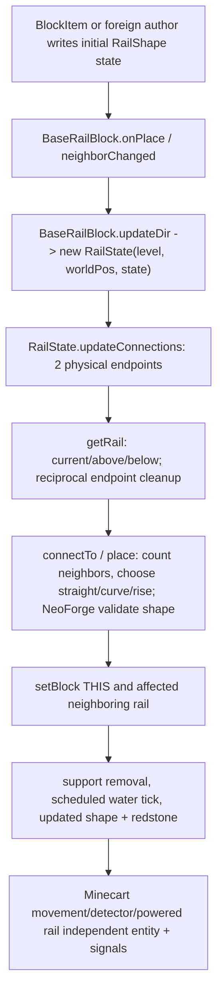

# Planetary — Stage 2.3C-17: RailState / BaseRailBlock physical slope graph, NeoForge rail extensions, independent mod tracks

**2026-10-12 · branch `2.0` · Minecraft 1.21.1 / NeoForge 21.1.215 / Java21** · one complete bounded **4/4 source+exact selected ASM contract** audit for original atlas **P28**. NOT production implementation, applied Mixin, real-client/loaded-mod compatibility, or game acceptance. Follows [C1–15 coverage gate](PHASE2_STAGE3C_1_TO_15_SCOPE_RECONCILIATION_AND_NEXT_OWNER_GATES_1_21_1.md), [C16](PHASE2_STAGE3C16_FRONT_AND_TOP_ROTATION16_STATE_TRANSFORMS_NEOFORGE_ASM_1_21_1.md), [3A-5 original rail source census](PHASE2_STAGE3A_RAIL_SOURCE_OWNER_AUDIT_1_21_1.md), [rail seam semantic contract](PHASE2_STAGE3A_RAIL_SEAM_FRAME_CONTRACT_1_21_1.md) and [C9 signal audit](PHASE2_STAGE3C9_REDSTONE_SIGNAL_PORTS_NEOFORGE_MOD_ASM_1_21_1.md). Strict selected target proof is the [C17 JUnit ASM contract](../../src/test/java/dev/planetary/world/Phase23C17RailGraphNeoForgeAsmContractTest.java), tested by CI independently.

## 1/4 — declaring owners and NeoForge patched rail extension path

Original unmodified NeoForge 21.1.215 bootstrap registry ZIP `11643813158` SHA256 `7937deee9221c2032a634d8355b8118b47efd9d905b2bb64152148c0174d090e` from run [37988064055](https://github.com/Abbygree11/Planetary/actions/runs/37988064055) pins **three concrete vanilla rail classes and four registered BLOCK IDs**:

| Registered class | Original exact BLOCK IDs | Lifecycle/transform distinction |
| --- | --- | --- |
| `RailBlock` | `minecraft:rail` | generic flexible rail; 10 `RailShape` flat/rising/corner variants |
| `DetectorRailBlock` | `minecraft:detector_rail` | straight-only six values, entity-inside detector, scheduled comparator/signal |
| `PoweredRailBlock` | `minecraft:powered_rail`, `minecraft:activator_rail` | two distinct registrations under same Java class, straight-only six values, signal walk and activator behavior |
| **Nonregistered essential owners** | `BaseRailBlock` (abstract) + `RailState` graph + `RailShape` (10 enum) | shared placement, support and **physical graph writer**, cannot be inferred from registered classes alone |

The original four rail BlockItems are normal `BlockItem` creators, independently checked in [3A-5.2](PHASE2_STAGE3A_RAIL_ITEM_ALTERNATE_AUTHORS_1_21_1.md). Alternative authors include direct `Level.setBlock`, mineshaft worldgen, commands/structures, updated neighboring rail writes, minecart signal/detection; **item use alone does not create the final graph**.

Pinned Mojang-mapped comparative MC1.21.1 Java sources at `hackersense/OptiFine-Source@b77c5c6995874f6cf2755bc5234428906b337b75` (OptiFine modifications may exist; exact ABI in *actual* Gradle-resolved classfile test):
- [BaseRailBlock](https://github.com/hackersense/OptiFine-Source/blob/b77c5c6995874f6cf2755bc5234428906b337b75/1.21.1/net/minecraft/world/level/block/BaseRailBlock.java) defines `getStateForPlacement/canSurvive/onPlace/updateState/updateDir/neighborChanged/shouldBeRemoved/onRemove/updateShape/getFluidState/getShape`.
- [RailState](https://github.com/hackersense/OptiFine-Source/blob/b77c5c6995874f6cf2755bc5234428906b337b75/1.21.1/net/minecraft/world/level/block/RailState.java) owns `updateConnections/removeSoftConnections/hasRail/getRail/hasConnection/countPotentialConnections/connectTo/place`. `place` and `connectTo` update **multiple world BlockStates** with `Level.setBlock`.
- [RailBlock](https://github.com/hackersense/OptiFine-Source/blob/b77c5c6995874f6cf2755bc5234428906b337b75/1.21.1/net/minecraft/world/level/block/RailBlock.java), [PoweredRailBlock](https://github.com/hackersense/OptiFine-Source/blob/b77c5c6995874f6cf2755bc5234428906b337b75/1.21.1/net/minecraft/world/level/block/PoweredRailBlock.java), [DetectorRailBlock](https://github.com/hackersense/OptiFine-Source/blob/b77c5c6995874f6cf2755bc5234428906b337b75/1.21.1/net/minecraft/world/level/block/DetectorRailBlock.java) independently implement concrete `rotate/mirror` shape transforms. PoweredRail traces physical signal through up to 8 rails, DetectorRail redstone/comparator reads minecart entities. Neither is a rail placement graph solver.
- [RailShape](https://github.com/hackersense/OptiFine-Source/blob/b77c5c6995874f6cf2755bc5234428906b337b75/1.21.1/net/minecraft/world/level/block/state/properties/RailShape.java) supplies N/S, E/W, four `ASCENDING_*`, and four corners; a full enum has 10, straight-only property restricts legal state domain to six.

**NeoForge patch adds real graph semantic extension points** (later comparative fixed commit `neoforged/NeoForge@3cae64530de368936d4c07497d3f0a25e2f9ffec`; verify actual target 21.1.215 via compiled ABI test, do NOT assert every future patch matches target):
- [`RailState.java.patch`](https://github.com/neoforged/NeoForge/blob/3cae64530de368936d4c07497d3f0a25e2f9ffec/patches/net/minecraft/world/level/block/RailState.java.patch): obtain graph state `BaseRailBlock.getRailDirection(state,level,pos,null)` and flexible policy `isFlexibleRail(state,level,pos)`, slope gate `canMakeSlopes(state,level,pos)`, and reject an authored connection/shape if `isValidRailShape(RailShape)` returns false. **This can make custom restricted mod rail shape vocabularies legal** without block-specific hardcoding.
- [`BaseRailBlock.java.patch`](https://github.com/neoforged/NeoForge/blob/3cae64530de368936d4c07497d3f0a25e2f9ffec/patches/net/minecraft/world/level/block/BaseRailBlock.java.patch): default `isFlexibleRail` (opposite `isStraight`) and `getRailDirection` (declared block shape property), and use the mod `getRailDirection` in neighbor removal and shape queries.
- [`IBaseRailBlockExtension`](https://github.com/neoforged/NeoForge/blob/3cae64530de368936d4c07497d3f0a25e2f9ffec/src/main/java/net/neoforged/neoforge/common/extensions/IBaseRailBlockExtension.java) is the **owning NeoForge API**, exposing six distinct mod contracts: `isFlexibleRail`, `canMakeSlopes`, `getRailDirection(BlockState, BlockGetter, BlockPos, @Nullable AbstractMinecart)`, `isValidRailShape`, `getRailMaxSpeed`, `onMinecartPass`. The cart parameter may be null in placement but not necessarily for vehicle simulation; don't globally replace this virtual dispatch.
- [`PoweredRailBlock.java.patch`](https://github.com/neoforged/NeoForge/blob/3cae64530de368936d4c07497d3f0a25e2f9ffec/patches/net/minecraft/world/level/block/PoweredRailBlock.java.patch) explicitly distinguishes activator from powered rail and broadens compatible powered neighbor subclass dispatch while preserving rail identity. [`DetectorRailBlock.java.patch`](https://github.com/neoforged/NeoForge/blob/3cae64530de368936d4c07497d3f0a25e2f9ffec/patches/net/minecraft/world/level/block/DetectorRailBlock.java.patch) allows analog comparator from custom minecart; concrete subclass signals not reducible to rail shape.
- [`AbstractMinecart.java.patch`](https://github.com/neoforged/NeoForge/blob/3cae64530de368936d4c07497d3f0a25e2f9ffec/patches/net/minecraft/world/entity/vehicle/AbstractMinecart.java.patch) and [`IAbstractMinecartExtension`](https://github.com/neoforged/NeoForge/blob/3cae64530de368936d4c07497d3f0a25e2f9ffec/src/main/java/net/neoforged/neoforge/common/extensions/IAbstractMinecartExtension.java) call rail direction per cart, speed caps, pass callbacks and independent powered functions. **Phase7** owns actual vehicle interpolation, gravity and traversal. Rotating RailState alone does NOT complete minecart navigation.

**Actual mod/NeoForge reference stronger than speculative third-party hook:** upstream [`ValidRailShapeTest.java`](https://github.com/neoforged/NeoForge/blob/3cae64530de368936d4c07497d3f0a25e2f9ffec/tests/src/main/java/net/neoforged/neoforge/oldtest/block/ValidRailShapeTest.java) registers a test `BaseRailBlock` with an `EnumProperty<RailShape>` restricted to **ascending** values and overriding `isValidRailShape`. A Planet rail algorithm that forcibly adds flat/corner values breaks this legitimate extension. This upstream *test source* is not executed in Planet CI.

**Independent real Create 1.21.1 mod** pinned `Creators-of-Create/Create@7ff2760e4924d35d4bc2e22c4b19923f0178cd16`: [TrackBlock](https://github.com/Creators-of-Create/Create/blob/7ff2760e4924d35d4bc2e22c4b19923f0178cd16/src/main/java/com/simibubi/create/content/trains/track/TrackBlock.java) **extends `Block`, NOT `BaseRailBlock`**, registers custom `EnumProperty<TrackShape>`, uses independent [TrackShape enum](https://github.com/Creators-of-Create/Create/blob/7ff2760e4924d35d4bc2e22c4b19923f0178cd16/src/main/java/com/simibubi/create/content/trains/track/TrackShape.java) with curves/crossings/portal, its own `getConnected` and `BezierConnection` BlockEntity graph, rotate/mirror map; [TrackBlockItem](https://github.com/Creators-of-Create/Create/blob/7ff2760e4924d35d4bc2e22c4b19923f0178cd16/src/main/java/com/simibubi/create/content/trains/track/TrackBlockItem.java) overrides vanilla BlockItem semantics. **Do not run Create rails through `RailState` or label Create-specific track geometry as automatically fixed by vanilla rail adapter.** Typed opt-in and source-owned connections in Phase10.

## 2/4 — full graph lifecycle, local-chart transport and bypasses

- **Vanilla physical assumptions are explicit:** `updateConnections` computes N/S/E/W physical `BlockPos`, four rising ends via `.above()` from an adjacent physical location, and legal corner endpoints only if rail is flexible. `getRail/hasRail` probe the candidate, candidate above and candidate below. `countPotentialConnections` iterates `Direction.Plane.HORIZONTAL` (world XZ). `hasConnection` compares only `BlockPos.getX/getZ`, ignoring Y *as a vanilla slope matching approximation*.
- On Planet ±X/±Z/-Y, local gravity DOWN is not physical `-Y`; local tangent plane is not global XZ. A simple `RailShape` rotate or `Direction` remap is insufficient: **all graph neighbor probes, endpoint ordering, 3-height candidates, reciprocal matches, slope support and write coordinates must transport through the target chart**. An endpoint may have different local frame from its source across an edge; a round-trip should preserve physical BlockPos identity without duplicate blocks.
- Distinguish *semantic graph endpoint* from *physical world-coordinate*. Proposed `PlanetRailGraphFrame` / `RailPort`: origin physical pos, target face/chart, local tangent direction, local rise, physical destination after `PlanetBlockStep`, reciprocal transported side; optional `Level` provenance. The default when no authoritative Planet frame (foreign worlds/contraption) remains **physical vanilla/mod path**.
- `BaseRailBlock.canSurvive` uses world `below`/rigid support; `shouldBeRemoved` additionally checks side support for ascent; `onRemove` sends notifications to world above for rising tracks. These are **different** support/neighbor owners than rail shape graph. `updateShape` reschedules `Fluids.WATER` tick when WATERLOGGED; **do not delete water updates** by short-circuiting rail graph.
- `RailState.place` mutates multiple states, so event/neighbor update flags matter. Avoid reentrant graph infinite loops at seams; ensure graph's source/target chain is bounded and physical `Level.setBlock` events remain NeoForge-visible. Must preserve `getRailDirection` dynamic virtual dispatch, shape validity, straight/no-slope capabilities and world/craft toggle.
- `PoweredRailBlock.findPoweredRailSignal/isSameRailWithPower` walks other rails (limited distance) and `DetectorRailBlock.entityInside/checkPressed/updatePowerToConnected` drive signals and rail-specific comparator data. These are **Phase7A** signal/capability algorithms, not just graph. Minecart `moveAlongTrack`, `IAbstractMinecartExtension`, velocity and endpoint interpolation must be separately completed in **Phase7**. Rendered rails, shadows, AO, collision/tessellation belong **Phase3**.
- **Alternate authors:** manual player place, no-player/dispenser/structure worldset, commands, mineshaft feature, rail state editing, redstone signal and vehicle events. `getStateForPlacement` only provides initial orientation; onPlace graph author may later rewrite states. Never assert direct setBlock physically transforms pre-authored state or that mods are covered simply by overriding `BlockItem`.

## 3/4 — deepest SAFE mod compatibility and version portability

| Domain | Policy | Why |
| --- | --- | --- |
| `PHYSICAL_DO_NOT_TOUCH` | world `Level`, `BlockPos`, vanilla `Direction`, `RailShape` and `RailState` global meaning, general `setBlock`/neighbor event flags, worldgen/foreign Levels, physical virtual Create `TrackShape` | Mods and legacy/foreign worlds rely on their own physical graph. Universal X/Y/Z overwrite breaks them. |
| `SHARED_SAFE` | Planet rail endpoint + local chart transport helper at **semantic graph port** boundary and explicit source provenance; preserve physical result/port reciprocity and typed allowed-state domain | Generalizable across vanilla rail classes and mod **inherited** `BaseRailBlock` when explicitly bound to Planet frame without subclass-specific hacks. |
| `OPT_IN_ALGORITHM` | `BaseRailBlock.isFlexibleRail/canMakeSlopes/isValidRailShape/getRailDirection`; local support query, ascent and neighboring rail rewrite; Phase7A signal follow-up; Phase7 vehicle movement | Contract must preserve actual per-block state and mod override, including restricted ascending-only shapes. |
| `MOD_INDEPENDENT` | Create TrackBlock / TrackShape / BezierConnection/TrackBlockItem, independent non-BaseRailBlock travel systems and virtual preview worlds | No shared RailState graph owner. Requires own compatibility adapter and real compiled+loaded mod tests; no automatic cross-mod claim. |

**Why not only a subclass Mixin:** subclasses may override virtual `getRailDirection` or entire graph and don't necessarily implement vanilla `RailState`. **Why not global `RailState` rewrite:** normal +Y vanilla rail, non-Planet worlds, fake guidebook Levels, context-free external mod graph and physical worldgen must continue unchanged. Version-portable core is a pure `RailPort` chart-transport and reciprocal graph query contract; thin 21.1.1 NeoForge adapter targets `BaseRailBlock` + `RailState` on Planet-owned levels only (actual typed implementation later in 2.4C). Crucially **do not modify production Mixins yet**: this is owner research and selected ABI validation.

## 4/4 — strict selected actual target NeoForge ASM/JUnit plus independent runtime gates

[Test `Phase23C17RailGraphNeoForgeAsmContractTest`](../../src/test/java/dev/planetary/world/Phase23C17RailGraphNeoForgeAsmContractTest.java) checks **actual class files of Gradle-loaded NeoForge21.1.215** (not comparative/source code): ten RailShape values; graph constructor/endpoint/elevation/connection methods; world XZ/y physical hardcoding; multi-write `RailState.place/connectTo`; `BaseRailBlock` author/survival/water tick; NeoForge rail extension and graph integration + restricted slope/shape guards; RailBlock/Powered/Detector independent rotate/mirror+signals; AbstractMinecart & NeoForge extension separate actual target ABI. Does **NOT** check applied Mixins, world/gameplay, correct frame transform, independent Create JAR, renderer or save/load.

| Gate | Result |
| --- | --- |
| 1/4 full declaring-owner Vanilla/NeoForge patch + real Create/source mod callsite map | AUDITED |
| 2/4 graph state lifecycle, all major bypasses, 10 shapes/six faces+seam semantics | AUDITED; proposed fixtures NOT RUN |
| 3/4 deepest safe source/world-aware mod boundary and portability | AUDITED; implementation PENDING |
| 4/4 strict Gradle target ABI contract added | TEST COMMITTED; GitHub Actions separately verify |
| Actual compiled Mixin applied in Minecraft, game survival placement, water, NeoForge event callbacks | **NOT RUN** |
| 6 faces, 12 edges, 8 corners, ascents+reciprocal junction tests, foreign world and modded restricted rail | **NOT RUN** |
| Actual loaded Create Train, vanilla Minecart, NeoForge `ValidRailShapeTest`, powered/activator/detector cart and renderer | **NOT RUN** |

### Future manual acceptance, independent from this research

1. Place each rail in survival with real item (all four IDs) on +Y, -Y, +X, -X, +Z, -Z: flat straight, legal corners and four ascents, unsupported support cleanup and aqua WATERLOGGED scheduling; no illegal curved powered/detector/activator rail.
2. At all 12 edges and 8 corners, build two-rail and three-rail connections/slope transition; compare both endpoint reciprocity and final neighbor BlockState, support removal/replacement, no reentrant loops or duplicate physical blocks; test no-Planet world.
3. Repeat after placing/rotating structure with already-authored `RailShape`, with worldgen mineshaft and player/dispenser direct item placement, restore/save/load, nearby concurrent updates.
4. Test modified `IBaseRailBlockExtension` custom straight/flexible/restricted ascending-only `isValidRailShape` + `canMakeSlopes`; ensure allowed state property vocabulary not violated and rejected new connection stays safe.
5. Check powered rail signal line length, activator and comparator/DetectorRail entities, minecart position speed, onMinecartPass once per tick, cross-edge interpolation (Phase7/7A), original physical Level/mod preview.
6. Test Create TrackBlock shape, custom BlockItem and independent Bezier graph with a genuinely version-compatible loaded 1.21.1 Create binary; no assumption that upstream latest NeoForge patch and Create loaded version match target21.1.215.

**NEXT**: after independent green GitHub Actions (and only then), advance P28 from `SPECIFIC_TARGET_GAP` to `SELECTED_SPECIFIC_ABI` in [40-row ledger](PHASE2_STAGE3C_P01_P40_ABI_COVERAGE_DISPOSITION_1_21_1.tsv), leaving P26 six-face attachment and P29 GrowingPlant directional head/body algorithms as remaining selected-target gaps. One coherent P26/P29 family per next `кк`, not one test per block.
