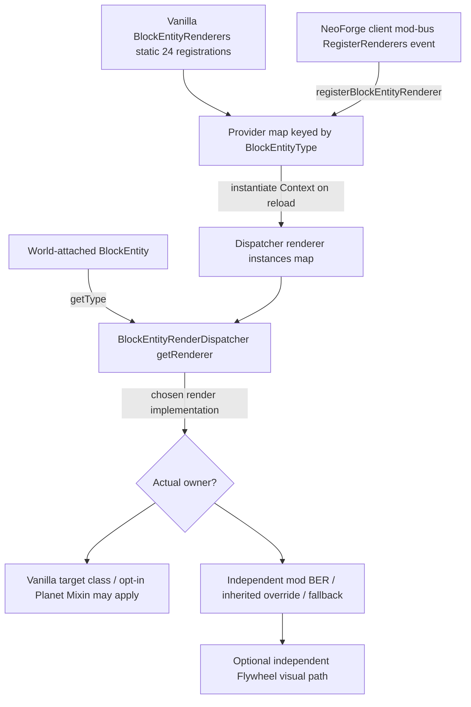

# Planetary — `3R-4D`: NeoForge BER provider map, dispatcher, mod factory and alternate renderer source audit

**Minecraft 1.21.1 / NeoForge 21.1.215 / Java 21 · branch `2.0` · RESEARCH ONLY.** Four parts: original event→factory provider→renderer map exact ABI; renderer inheritance and frame/instance versus dynamic provider dispatch; pinned compatible-version Create/AE2 implementation counterexamples and 40-route acceptance; original CI and handoff. No production Java, Mixins, V8 lab, worlds, or `main` edits. Research **R** and actual client visual **V** remain OPEN.

## 1/4 — Original target NeoForge factory and dispatch mechanism

Prior original [`3R-4A`](PHASE3_R4A_ORIGINAL_VANILLA_BER_REGISTRY_AND_OWNER_1_21_1.md), [`3R-4B`](PHASE3_R4B_SIGN_BANNER_SKULL_NESTED_RENDER_SOURCE_1_21_1.md) and [`3R-4C`](PHASE3_R4C_REMAINING_BER_ORIGINAL_NESTED_SPACE_AND_MOD_1_21_1.md) establish all **24 vanilla BlockEntityType registrations / 22 concrete factory owners** and selected original Java21 render method bodies; **not** the final factory provider selected after mod initialization. The main question is no longer whether a certain block draws, but whether a given instance dispatches into the original class at all.

**Source chain to verify on compiled target:**

A `Map.put(type, provider)` allows a provider to replace one mapped for that type if invoked later. **This is a property of the registry API, not a claim that AE2/Create actually overrides vanilla SIGN/BANNER/SKULL; the inspected releases register their own block entity types.** Provider constructor map and instantiated dispatcher map are distinct: replacing a provider does not necessarily replace an already instantiated renderer until reload/recreation. Do not infer exact mod registration order, how many modded providers win or Java client Mixin weaving without a loaded runtime.

New strict [`Phase3R4DNeoForgeBerProviderDispatchAsmTest`](../../src/test/java/dev/planetary/world/Phase3R4DNeoForgeBerProviderDispatchAsmTest.java) reads exact compiled original classfiles from the resolved NeoForge21.1.215 test dependency (not a source clone). Expected eight: `EntityRenderersEvent$RegisterRenderers`, `BlockEntityRenderers`, `BlockEntityRenderDispatcher`, `BlockEntityRenderer`, `BlockEntityRendererProvider`, nested `Context`, `IBlockEntityRendererExtension`, `ClientHooks`. It emits SHA256, superclass/interfaces and all methods/invocations, ordered selected method opcodes for registration/getRenderer/render/renderItem/reload, and verifies original direct chains **NeoForge event → BlockEntityRenderers.register**, **factory register → map.put**, **dispatcher getRenderer → map.get**, **dispatcher resource reload → BlockEntityRenderers.createEntityRenderers**. Reports are saved in `build/reports/planetary/phase3-r4d-original-ber-provider-*.tsv` and `*-summary.txt`; original test execution status must be verified separately.

Readable comparison only: pinned [NeoForge 1.21.1 branch commit `624c929`](https://github.com/neoforged/NeoForge/blob/624c929f49920c250166e2a8df7af87f16d220ef/src/main/java/net/neoforged/neoforge/client/event/EntityRenderersEvent.java) has `RegisterRenderers.registerBlockEntityRenderer → BlockEntityRenderers.register`, with client mod-bus event. This October 2026 branch state is **not** itself the original 21.1.215 release and cannot substitute test classfiles. Independent 1.21.1 [vanilla-like comparator](https://github.com/hackersense/OptiFine-Source/blob/b77c5c6995874f6cf2755bc5234428906b337b75/1.21.1/net/minecraft/client/renderer/blockentity/BlockEntityRenderDispatcher.java) contains `getRenderer`, `render`, `renderItem`, and `onResourceManagerReload`; OptiFine changes are non-authoritative until exact compiled original ABI check.

## 2/4 — Selected real released mods, not invented sibling equivalence

The two pins are immutable released source refs:
- [**AE2 NeoForge 19.2.18**](https://github.com/AppliedEnergistics/Applied-Energistics-2/tree/db17504a86128fdf3dae31f5fb7a112a646e0b93) targeting Minecraft 1.21.1 (tag `neoforge/v19.2.18`). `AppEngClient.registerEntityRenderers` explicitly calls `event.registerBlockEntityRenderer` **10 times** for `CRANK`, `INSCRIBER`, `SKY_CHEST`, `CHARGER`, `DRIVE`, `ME_CHEST`, `CRAFTING_MONITOR`, `MOLECULAR_ASSEMBLER`, `CABLE_BUS`, `SKY_STONE_TANK`. `ME_CHEST` factory constructs **`appeng.client.render.tesr.ChestBlockEntityRenderer`**, not the vanilla `ChestRenderer`; it manipulates `PoseStack`, uses BlockOrientation quaternion, calls `BlockRenderer.tesselateBlock` and `CellLedRenderer.renderLed`. CHARGER uses a `ChargerBlockEntityRenderer.FACTORY` backed by `ModularTESR` and nested item renderable. [Source registration](https://github.com/AppliedEnergistics/Applied-Energistics-2/blob/db17504a86128fdf3dae31f5fb7a112a646e0b93/src/main/java/appeng/core/AppEngClient.java), [custom chest implementation](https://github.com/AppliedEnergistics/Applied-Energistics-2/blob/db17504a86128fdf3dae31f5fb7a112a646e0b93/src/main/java/appeng/client/render/tesr/ChestBlockEntityRenderer.java).
- [**Create 6.0.10 / Minecraft 1.21.1**](https://github.com/Creators-of-Create/Create/tree/ac0c444d9828da3453ae8cc65338e8de063286fb) (tag `mc1.21.1-6.0.10`). Actual `AllBlockEntityTypes.java` contains **104 textual `.renderer(` registrations and 69 `.visual(` registrations** through Registrate (not claimed distinct initialized runtime instances). `SafeBlockEntityRenderer<T>.render` is **final**, delegating to `renderSafe`; `KineticBlockEntityRenderer.renderSafe` immediately returns if `VisualizationManager.supportsVisualization(be.getLevel())`, delegating the rendering path to Flywheel when available, otherwise builds the model buffer/rotating geometry. A vanilla SignRenderer Mixin cannot intercept this unrelated hierarchy, and a generic BER wrapper may double-transform geometry when visualization is enabled. [Pinned type registration](https://github.com/Creators-of-Create/Create/blob/ac0c444d9828da3453ae8cc65338e8de063286fb/src/main/java/com/simibubi/create/AllBlockEntityTypes.java), [KineticBlockEntityRenderer](https://github.com/Creators-of-Create/Create/blob/ac0c444d9828da3453ae8cc65338e8de063286fb/src/main/java/com/simibubi/create/content/kinetics/base/KineticBlockEntityRenderer.java), [SafeBlockEntityRenderer](https://github.com/Creators-of-Create/Create/blob/ac0c444d9828da3453ae8cc65338e8de063286fb/src/main/java/com/simibubi/create/foundation/blockEntity/renderer/SafeBlockEntityRenderer.java).

**Version gate:** prior Create 6.0.10 binaries are built with NeoForge 21.1.219 rather than Planet's 21.1.215. Until exact runtime class loading or dependency compatibility is proven, **Create is RELEASE-SOURCE ONLY / NOT LOADED / LOADER ACCEPTANCE OPEN**. AE2 is also **RELEASE-SOURCE ONLY**; its 1.21.1 and NeoForge flavor are confirmed by release, but no actual Planet-loaded-client compatibility test. No specific sampled mod is claimed to replace a vanilla existing provider.

## 3/4 — 40 owner/bypass/coordinate/acceptance routes

[40-route authoritative research matrix](PHASE3_R4D_NEOFORGE_MOD_BER_PROVIDER_OWNER_MATRIX_1_21_1.tsv) explicitly separates original engine API/dispatcher/factory/reload, 10 AE2 concrete registrations, AE2 nested custom renderers, Create Registrate `.renderer` and `.visual`, final Safe BER, Flywheel short-circuit, mod subclasses/delegation and extensions, foreign/fake Level/BEWLR, mod instance/world renderer and client 6 faces/12 seams/8 corners/+Y/noPlanet. A custom `BlockEntityType` or matching name (such as AE2 ME chest versus vanilla chest) does not establish the same runtime owner.

**Highest safe future seam:** first identify actual instance renderer factory, its geometry writer and source `Level`, `BlockPos`, camera/physical light, then apply a narrow frame transform only if that nested owner is locally rigid. Never globally rewrite `BlockEntityRenderDispatcher.render` or `PoseStack`. For mixed shader/portal/entity/camera or Flywheel visual, separate geometry/world-frame and physical/camera-sampling consumers, and mark independent mod GPU pipeline for `3R-5`. ModelData reload/region worker epoch and exception-scope belong `3R-6`. Existing Planet sign/hanging/banner/skull HEAD/RETURN scopes and Bed remain provisional, not replaced here.

All gameplay acceptance OPEN: generated vs player-placed chains, natural LIME sign and forced CYAN FACING/ROTATION_16/ATTACHED, same world +Y/noPlanet regression, each legal of six gravity faces, 12 seams/8 corners, actual applied Mixin, actual AE2/Create installed client, renderer replacement/getRenderer class before/after resource reload, GUI/no-Level boundary. Do not claim universal mod support from API or source.

## 4/4 — Actual CI, original evidence and next handoff

**`3R-4D` bounded source/ABI 4/4 COMPLETE; whole Phase3 R and visual game V still OPEN.** Original [CI #40553809343 SUCCESS](https://github.com/Abbygree11/Planetary/actions/runs/40553809343), test commit [`441203bc`](https://github.com/Abbygree11/Planetary/commit/441203bc3a58b8cc5ef0f9e5a78ddbe1c34741ab): Java21 production and test compilation, full JUnit including new exact-class NeoForge ASM and registry census. Downloaded original artifact **12756840569** ZIP SHA256 **`7d1d239e800dca80119870c5fd99955ffb9485e33b2ebb717d264ec7a8b5e444`**. All eight actual compiled target classes present; **160 method declarations / 616 direct INVOKEs / 213 selected ordered JVM instructions**. Independently unpacked, checked five member hashes and nine original direct declaring-owner↔target JVM call paths with [pinned archive checker](../../scripts/research/phase3_r4d_original_ber_provider_verify.py) (script committed **after** test success, not falsely claimed as invoked in original CI).

| Original archive member | SHA256 |
| --- | --- |
| `phase3-r4d-original-ber-provider-owners.tsv` | `fa5c4bdc60c97e9775129060dd6e799d3682ea1a99c777d3ad38017e16aa0e20` |
| `phase3-r4d-original-ber-provider-methods.tsv` | `24e870e49f58b405b7a375a4c4159473a47867022644a2a9c81a73f80a3260a0` |
| `phase3-r4d-original-ber-provider-invokes.tsv` | `d5f1491aaf4c72951194253240bc39778ba88ca3d47365d58293d38a58d56c3f` |
| `phase3-r4d-original-ber-provider-instructions.tsv` | `fbd6d0c1ae8855b15be0033b444c94deadc00e8a105cdd6f236224b5727bb1c5` |
| `phase3-r4d-original-ber-provider-summary.txt` | `2f39642d76724aba06584f650909420bed954812e035aad2addf87afdde295b9` |

**Verified exact original edges:** `RegisterRenderers.registerBlockEntityRenderer → BlockEntityRenderers.register` (1); `BlockEntityRenderers.register → Map.put` (1); `createEntityRenderers → Map.forEach` (1); `lambda$createEntityRenderers$0 → BlockEntityRendererProvider.create` (1); `BlockEntityRenderDispatcher.onResourceManagerReload → BlockEntityRenderers.createEntityRenderers` (1); `getRenderer → Map.get` (1); `render → getRenderer` (1); `renderItem → getRenderer` (1); `render → BlockEntityRenderer.shouldRender` (1). Original renderer interface extends NeoForge `IBlockEntityRendererExtension`. These facts validate the static API path, **not the active factory ordering or live mod client**. Exact source callback origin for `RegisterRenderers` posting remains distinct from target method trace and will be reconciled in the phase-wide lifecycle audit.

No initial test failures in this packet. **Selected 8-class target/10-AE2/104-Create source census has a precise evidence boundary:** it does not prove that all possible modded BERs are handled, and no actual third-party renderer was installed or swapped under Planet during this packet.

**Next `3R-5`:** independent non-vanilla/Flywheel accelerated renderer + custom model/virtual-world and shaders, original 3D owner and class/library evidence, precise fallback/unsupported scope; after `3R-6` client resource/worker epoch lifecycle, `3R-7` entire Phase3 source R gate. Only after R PASS return to minimal shared Phase2 visual runtime fixes and real game V, then resume `2.4A` without repeated unresearched jumps. `main` untouched.
